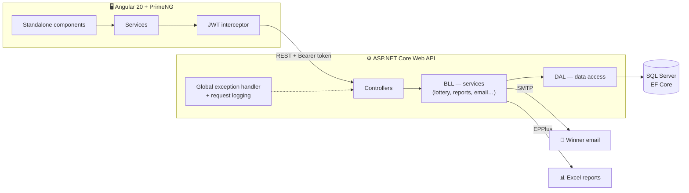
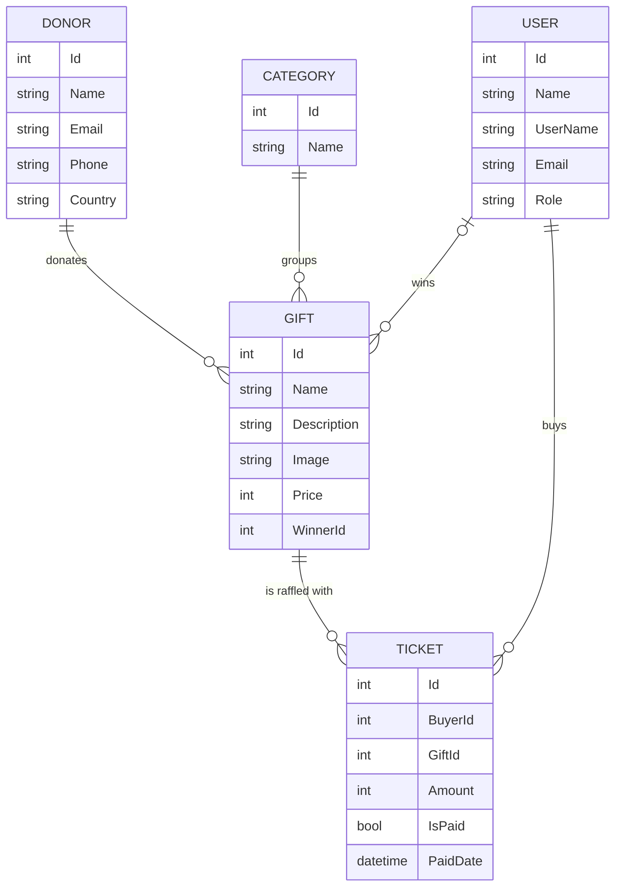

# 🎁 Chinese Auction — Charity Raffle Platform

> A full-stack web app for running a charity "Chinese auction": donors contribute gifts, buyers fill a basket with raffle tickets, and an admin draws a fair, **ticket-weighted** winner for each gift — who instantly receives a styled congratulations email. Admins can also export **Excel reports** of winners and revenue.

[](https://angular.dev)
[](https://primeng.org)
[](https://www.typescriptlang.org)
[](https://dotnet.microsoft.com)
[](https://learn.microsoft.com/ef/core)
[](https://www.microsoft.com/sql-server)
[](https://jwt.io)

---

## ✨ Features

### 🛍️ For buyers
- **Browse the gift catalog** in grid or list view, search by donor, and sort by price, category or number of buyers
- **Gift detail pages** with image, description, donor and ticket price
- **Shopping basket** of raffle tickets — add, change quantities, remove
- **Checkout page** with live validation (Luhn card check, expiry, CVV) and auto-formatting of card fields
- Register and log in securely

### 🛠️ For admins
- **Manage gifts** — create, edit and delete gifts, assign each to a donor and category
- **Manage donors** — full CRUD for donor details
- **Run the raffle** — draw a winner per gift, or **"draw all"** in one click
- **Automatic winner email** — an RTL, branded HTML email is sent to every winner over SMTP
- **Excel reports** — download *Gift Winners* and *Sales Revenue* reports, generated on the server

### 🎲 How the draw works
Every buyer enters the draw **once per paid ticket**, so someone with 5 tickets has 5× the chance of someone with 1. A gift that already has a winner can't be drawn again.

```csharp
var participants = gift.Tickets
    .SelectMany(t => Enumerable.Repeat(t.BuyerId, t.Amount))
    .ToList();

gift.WinnerId = participants[rnd.Next(participants.Count)];
```

---

## 🧭 Architecture



**Backend — 3-tier design:** `Controllers → BLL (business logic) → DAL (data access)`, with an interface for every service and DAL class, all wired through ASP.NET Core dependency injection.

**Cross-cutting concerns**
- 🔐 **JWT authentication + role-based authorization** (`Admin` / `Buyer`), passwords hashed with **BCrypt**
- 🛡️ **Global exception-handling middleware** mapping custom exceptions to HTTP codes: `BusinessException → 400`, `NotFoundException → 404`, `ConflictException → 409`
- 📦 A unified **`ApiResponse`** envelope for consistent responses
- 🔁 **AutoMapper** between entities and DTOs, so entities never leak to the client
- 📝 **Request-logging middleware**
- 🔑 Secrets kept out of source control with **.NET User Secrets**

---

## 🗄️ Data Model



---

## 🔌 API Overview

| Area | Endpoints | Access |
|---|---|---|
| **Auth** | `POST /api/Auth/login` · `POST /api/Auth/register` | Public |
| **Gifts** | `GET /api/Gift` · `GET /api/Gift/{id}` | Public |
| | `POST` · `PUT` · `DELETE /api/Gift/{id}` · `DELETE /api/Gift/all` | Admin |
| **Donors** | `GET /api/Donor` · `GET /api/Donor/{id}` | Public |
| | `POST` · `PUT` · `DELETE /api/Donor/{id}` | Admin |
| **Categories** | `GET /api/Category` | Public |
| | `POST` · `DELETE /api/Category/{id}` | Admin |
| **Tickets** | `GET /api/Ticket/draft/{buyerId}` · `POST` · `PUT /amount/{id}` · `PUT /pay/{id}` · `DELETE /{id}` | Buyer |
| | `GET /api/Ticket/paid` · `GET /api/Ticket/paid/{giftId}` · `GET /api/Ticket/user/{buyerId}` | Signed in |
| **Lottery** | `POST /api/Lottery/{giftId}` | Admin |
| **Reports** | `GET /api/Report/gift-winners` · `GET /api/Report/sales-revenue` → `.xlsx` | — |
| **Email** | `POST /api/email/send` | Admin |

Full interactive docs are available in **Swagger** when running in development.

---

## 🚀 Getting Started

### Prerequisites
- [.NET 7 SDK](https://dotnet.microsoft.com/download) (or later)
- [Node.js 20+](https://nodejs.org) and npm
- SQL Server (LocalDB / Express / full)
- An SMTP account for sending winner emails (e.g., a Gmail app password)

### 1️⃣ Clone
```bash
git clone https://github.com/yael-72/chinese-auction-angular-aspnet-core.git
cd chinese-auction-angular-aspnet-core
```

### 2️⃣ Configure the server secrets
```bash
cd Server/Api
dotnet user-secrets set "Jwt:Key" "<random key, at least 32 characters>"
dotnet user-secrets set "ConnectionStrings:DefaultConnection" "<your SQL Server connection string>"
dotnet user-secrets set "EmailSettings:From" "<sender email>"
dotnet user-secrets set "EmailSettings:Username" "<SMTP username>"
dotnet user-secrets set "EmailSettings:Password" "<SMTP app password>"
```

### 3️⃣ Create the database and run the API
```bash
dotnet ef database update
dotnet run --launch-profile https
# API → https://localhost:7128   ·   Swagger → https://localhost:7128/swagger
```

### 4️⃣ Run the client
```bash
cd ../../Client
npm install
npm start
# App → http://localhost:4200
```

---

## 📁 Project Structure

```
├── Client/                         # Angular 20 SPA
│   └── src/app/
│       ├── Components/
│       │   ├── Feature/
│       │   │   ├── Auth/           # login, register
│       │   │   ├── Donor/          # donor management
│       │   │   ├── Gift/           # list, detail, manage, draw spinner
│       │   │   └── Ticket/         # basket, payment
│       │   ├── home/ · navigation/ · footer/ · shared/
│       ├── services/               # HTTP services per domain (+ unit specs)
│       ├── model/                  # TypeScript models
│       ├── authInterceptor.ts      # attaches the JWT to every request
│       └── app.routes.ts
│
└── Server/
    └── Api/                        # ASP.NET Core Web API
        ├── Controllers/            # Auth, Gift, Donor, Category, Ticket, Lottery, Report, Mail
        ├── BLL/                    # Business logic + interfaces
        ├── DAL/                    # Data access + DbContext + interfaces
        ├── Models/  (+ DTO/)       # Entities and DTOs
        ├── Middleware/             # Global exception handler, request logging
        ├── Exceptions/             # Business / NotFound / Conflict
        ├── Migrations/             # EF Core code-first migrations
        └── Program.cs
```

📄 More detail on the backend's error-handling design: [ERROR_HANDLING_ARCHITECTURE.md](Server/ERROR_HANDLING_ARCHITECTURE.md)

---

## 💡 What I Practiced in This Project

- Designing a clean **3-tier backend** with interfaces and dependency injection throughout
- Implementing **JWT auth with roles** end to end — from token issuing to an Angular interceptor and role-aware UI
- Writing a **fair weighted random draw** and protecting it from double draws
- Generating **Excel files on the server** and downloading them from the browser
- Sending **HTML emails** over SMTP as part of a business flow
- Centralizing error handling so the client always gets predictable responses
- Building a rich, **RTL Hebrew UI** with PrimeNG components (DataView, Select, InputGroup…)

---

## 👩‍💻 Author

**Yael Turk** — Full-Stack Developer (C# · .NET · Angular · SQL)

[](https://github.com/yael-72)

⭐ If you liked this project, a star is always appreciated!
